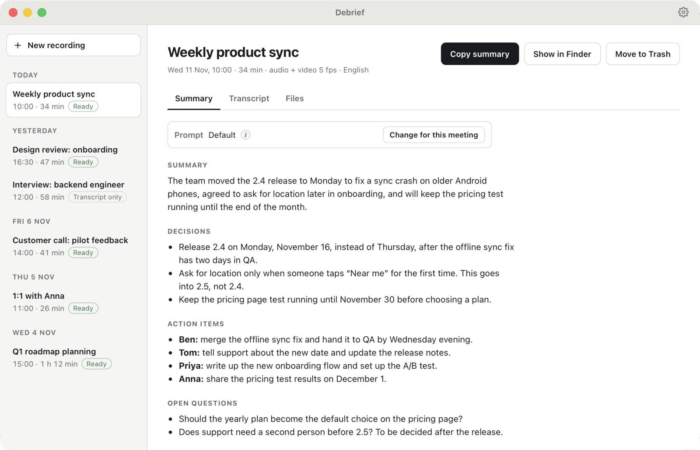
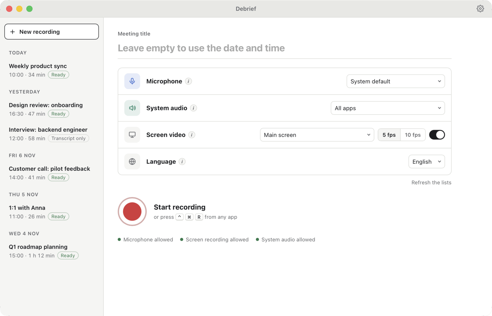
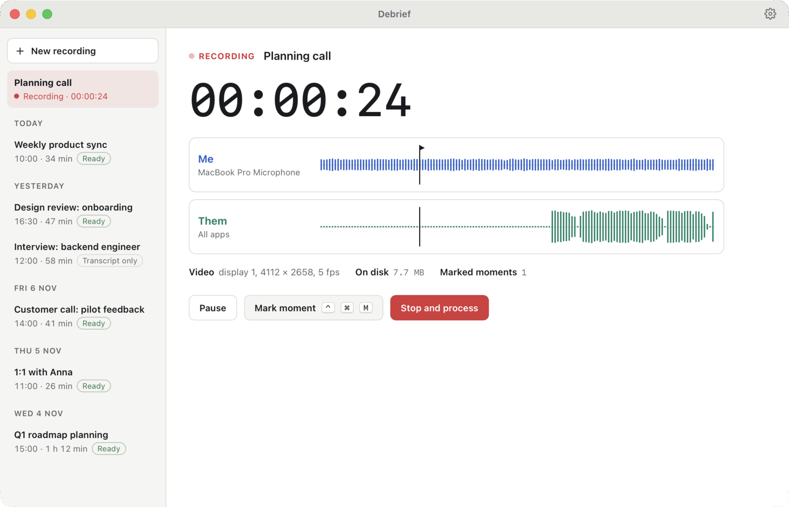
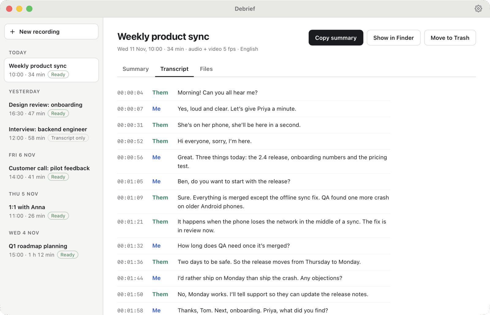
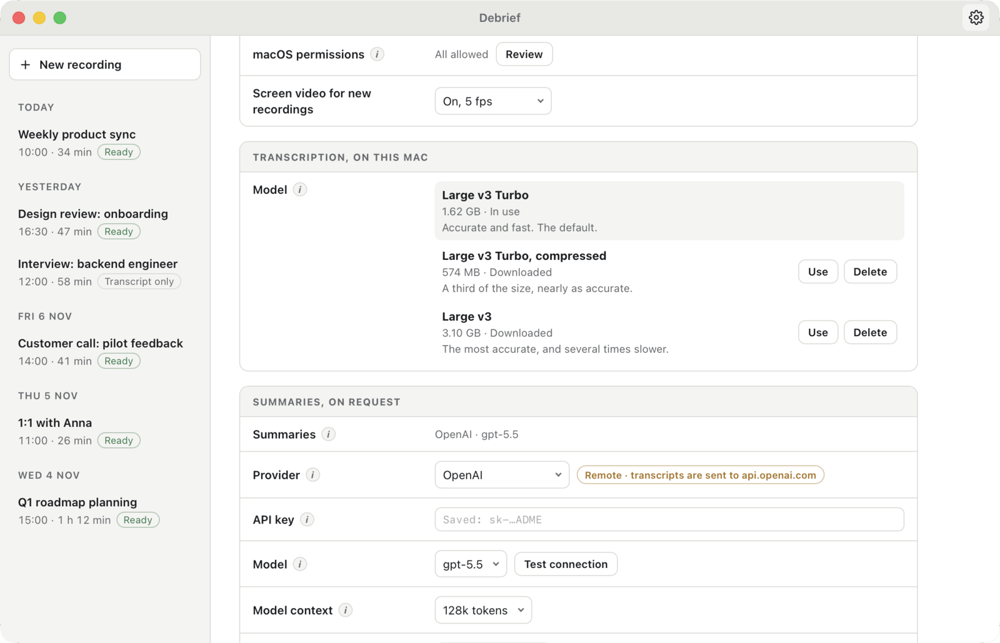
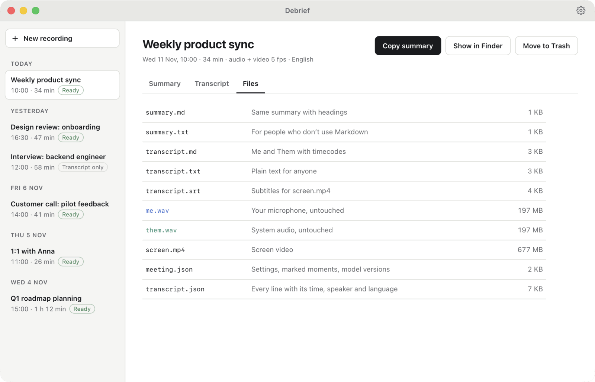

<p align="center">
  
</p>

<h1 align="center">Debrief</h1>

<p align="center">
  Record a meeting on your Mac and get a transcript, plus a summary when you want one.<br>
  Everything is saved as plain files that you own.
</p>

<p align="center">
  <a href="https://github.com/ksilisk/debrief/releases/latest"></a>
  
  <a href="LICENSE"></a>
</p>



## Why Debrief

- **Works with any call app.** Zoom, Google Meet, Teams, Telegram or a browser tab: Debrief records the sound on your Mac. No bot joins your call.
- **Knows who spoke.** Your microphone (“Me”) and the sound of the call (“Them”) are recorded as separate tracks. When your microphone picks up the speakers, Debrief removes those repeated lines.
- **Private.** Whisper turns speech into text on your Mac. Audio and video never leave it.
- **Summaries only when you ask.** Click **Write summary** and the transcript goes to OpenAI or Claude, with a prompt you can change for each meeting.
- **Plain files.** Each meeting is a folder of Markdown, text and subtitle files. No account, no cloud and nothing to export.

## How it works

### 1. Start a recording

Choose a microphone, the call audio (all apps or just one) and, if you like, screen video at 5 or 10 frames per second. Press <kbd>⌃</kbd><kbd>⌘</kbd><kbd>R</kbd> in any app to start or stop.



### 2. Have your meeting

You see both tracks live. Pause when you need to, and press <kbd>⌃</kbd><kbd>⌘</kbd><kbd>M</kbd> to mark a moment you want to find later.



### 3. Read the transcript

When you stop, Debrief transcribes both tracks on your Mac and puts the lines in time order. You can close the window: a notification tells you when the transcript is ready.



### 4. Get a summary, if you need one

Click **Write summary** to get a short summary with decisions, action items and open questions. Then click **Copy summary** to paste it into a chat or an email. The prompt is plain text. You can change the default prompt, or give a single meeting its own, for example with the names of the people who took part.

## Install

You need a Mac with Apple silicon (M1 or later) and macOS 15 Sequoia or later.

1. Download `Debrief_<version>_aarch64.dmg` from the [latest release](https://github.com/ksilisk/debrief/releases/latest).
2. Open it and drag **Debrief** to **Applications**.
3. Open Debrief. The first time, macOS blocks it, because Debrief is signed with the author’s own certificate rather than a paid Apple Developer ID. Click **Done**, open **System Settings → Privacy & Security**, scroll down and click **Open Anyway** next to the message about Debrief. You only do this once. Updates install from inside the app.
4. Allow what Debrief asks for. It shows a short checklist:

   | Permission | Why |
   |---|---|
   | Microphone | Records your voice as the “Me” track. |
   | Screen & System Audio Recording | Debrief uses macOS screen capture, even for audio only. Quit and reopen Debrief after you turn it on. |
   | System Audio Recording | Records the sound of the call as the “Them” track. |
   | Documents folder | Meetings are saved in `~/Documents/Debrief`. You can choose another folder in Settings. |

5. Download a speech model with one click. The default, Large v3 Turbo, is 1.6 GB. A compressed version (574 MB) and the slower but more accurate Large v3 (3.1 GB) are also in Settings.

## Your data

- Recording and transcription happen on your Mac. Nothing is uploaded.
- When you click **Write summary**, only the transcript text is sent, and only to the provider you set up. The app shows where it goes before you click.
- Your API key is kept in a file that only your macOS user can read, never in the meeting folders.
- There is no account and no analytics. Besides summaries, Debrief goes online only to download a speech model (from Hugging Face) and to check for updates (on GitHub).



## What you get

Each meeting gets its own folder, such as `2026-11-11 10-00 Weekly product sync`. Open the files with any app, send them to anyone, or keep them in your notes.



## Good to know

- **Early version.** Debrief is at v0.3 and works for everyday meetings, but expect rough edges. Bug reports are welcome in [Issues](https://github.com/ksilisk/debrief/issues).
- **Languages.** Choose Russian, English or Auto for each meeting. With Auto, each side can speak its own language, but a track that switches languages midway is not handled well yet.
- **Disk space.** Audio is saved as WAV, about 700 MB per hour for both tracks. Screen video adds about 0.6 to 1.3 GB per hour. Settings can move old recordings to the Trash after 30 days, 90 days or a year, and keep the transcripts and summaries.
- **Platforms.** macOS only for now. Windows and Linux are planned.
- **Summary providers.** OpenAI and Claude for now. More, including local models, are planned.

## Command line

The `debrief` command records, transcribes and summarizes without the window:

```bash
cargo run -p debrief-cli -- --help
```

It can list the microphones and apps you can record (`sources`), record (`record`), transcribe (`process`), download speech models (`model`), write summaries (`summarize`) and set up summaries (`config`).

## Build from source

You need macOS 15 or later, Xcode 26, Rust (stable, 1.89 or later) and Node.js.

```bash
cd app
npm install
npm run tauri dev      # run the app with hot reload
npm run tauri build    # build Debrief.app and a DMG
```

See [`docs/architecture.md`](docs/architecture.md) for how Debrief works inside: the stack, the processing steps and the meeting folder format.

## License

[MIT](LICENSE)
